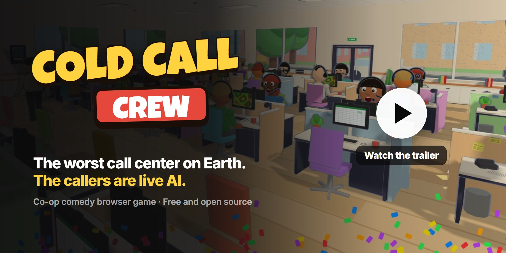
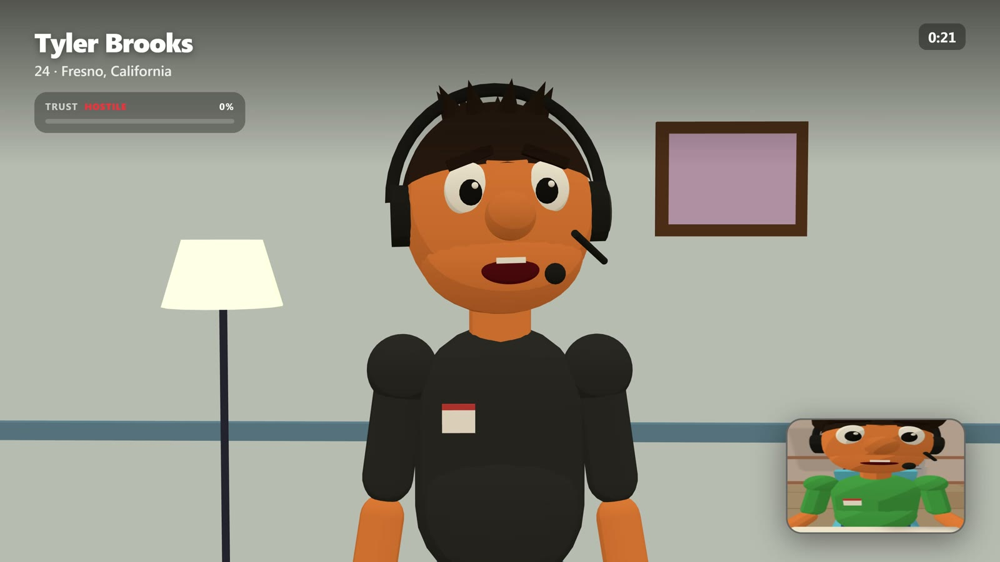
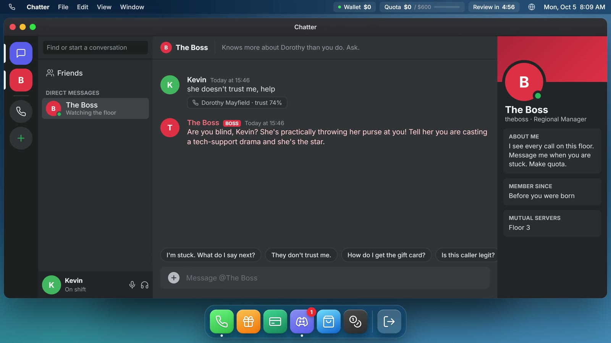
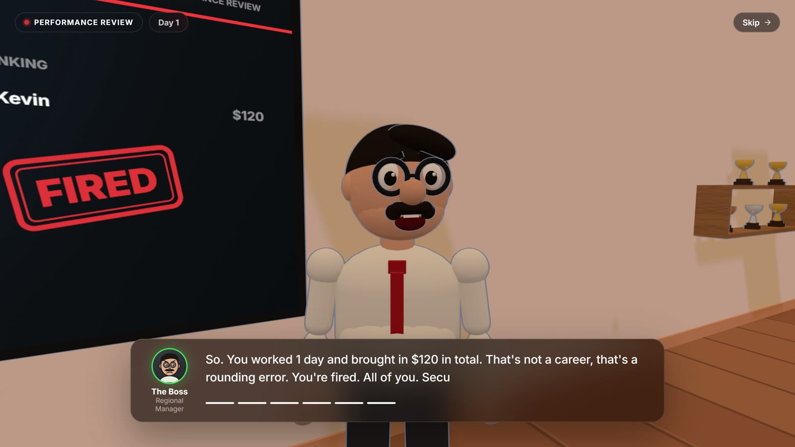
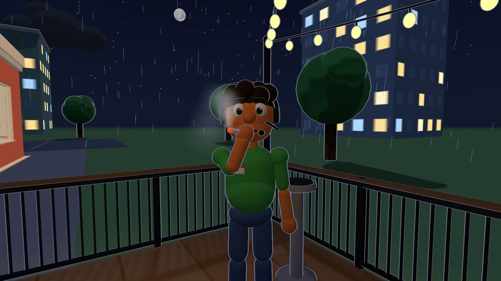

# Cold Call Crew

A co-op comedy game about the worst call center on Earth, played in the browser. You and your friends sit at desks in a 3D office and cold-call people. The callers are played live by AI: they hear what you say, argue back, get confused, curse you out and hang up. Make quota before the end-of-day review, or the boss fires all of you.

Nothing to download for players: one person runs the server, everyone else opens a link in Chrome or Edge.

It's satire. Every caller, company and dollar in the game is fictional.

[](https://www.youtube.com/watch?v=59PPWtRvRPY)

| | |
|---|---|
|  |  |
|  |  |

## Features

- Voice calls with AI callers. Talk into your mic and interrupt them mid-sentence, the way you would on a real call. Typing works too.
- Every caller is different: grandmas, gamers, truckers, scambaiters. Some fall for it, most don't.
- Missions on every call: gift cards, credit card "renewals", remote desktop "support".
- Callers in 8 languages: English, Spanish, French, German, Italian, Portuguese, Arabic and Hebrew.
- An in-game desktop with a phone, Chatter (ask the boss for help mid-call), Gift Cards, Credit Card, Scamazon and more.
- Multiplayer crews with proximity voice chat, right in the browser.
- A 3D office to waste time in: basketball, a jukebox, an arcade machine, smoke breaks, weather and time of day, pranks.
- End-of-day reviews where the boss reads your worst lines back to you.

## Requirements

- [Node.js](https://nodejs.org) 20 or newer, on the computer that runs the server
- Chrome or Edge for everyone who plays
- A Gemini API key for the AI callers and their voices. The free tier is enough to play. You can get one at [Google AI Studio](https://aistudio.google.com/apikey).

Without a key the game still runs, with a simpler built-in caller instead of AI.

## Install

```bash
git clone https://github.com/NaorX/cold-call-crew.git
cd cold-call-crew
npm install
```

Copy the example config and add your key:

```bash
cp .env.example .env
```

On Windows use `copy .env.example .env`. Then open `.env` and paste your key after `GEMINI_API_KEY=`.

## Run

```bash
npm run dev
```

Open http://localhost:5173. Allow the microphone when the browser asks.

To run a build instead (one port, no dev server):

```bash
npm run build
npm start
```

Then open http://localhost:8787.

## Playing with friends

One player hosts: **Play → Host a crew**. The crew code shows on the laptop in the break room and in the player list (Tab). Everyone else picks **Join by code**.

Your friends don't install anything. They just need to reach the machine that runs the server, in their browser:

- **Same network:** run the build (`npm run build`, `npm start`) and have them open `http://YOUR-LOCAL-IP:8787`.
- **Over the internet:** run the build and expose port 8787 with a tunnel, for example `ngrok http 8787`, then share the link.

## Controls

| Key | |
|---|---|
| WASD, Shift, Space | Move, run, jump |
| Mouse | Look (click to capture the mouse) |
| E | Use: sit down, use the computer, pick things up |
| Esc | Leave the computer |
| F | First person / third person |
| Tab | Player list |
| M | Mute voice chat |
| C | Coffee |

## Configuration

All settings live in `.env`.

| Variable | |
|---|---|
| `GEMINI_API_KEY` | Your Gemini key. Turns on AI callers, voices and live calls. |
| `GEMINI_MODEL` | Model for caller dialogue. By default the newest Flash model on your key. |
| `GEMINI_TTS_MODEL` | Model for voices. By default the newest TTS model on your key. |
| `GEMINI_LIVE_MODEL` | Model for live voice calls. |
| `ANTHROPIC_API_KEY` | Optional. Use Claude for caller dialogue instead (voices still need Gemini). |
| `AI_PROVIDER` | `gemini` or `claude`, if both keys are set. |
| `PORT` | Server port. Default 8787. |

## Project layout

| Folder | |
|---|---|
| `src/engine` | The 3D world: office, characters, camera, effects |
| `src/os` | The in-game desktop and its apps |
| `src/game` | Calls, missions, callers, audio, networking |
| `src/ui` | Menus, HUD, the end-of-day review |
| `src/shared/room.js` | Shift rules, shared by the server and solo play |
| `server` | Node server: AI callers, voices, live calls and crew rooms |

All sound is synthesized and all textures are drawn in code, so there are no asset files.

## Contributing

Issues and pull requests are welcome. Please run `npm run typecheck` before opening a PR.

## License

MIT, see [LICENSE](LICENSE). Parts of the 3D world are based on [Agent Office](https://github.com/AgentSystemLabs/agent-office) (MIT), see [THIRD_PARTY_NOTICES.md](THIRD_PARTY_NOTICES.md).
